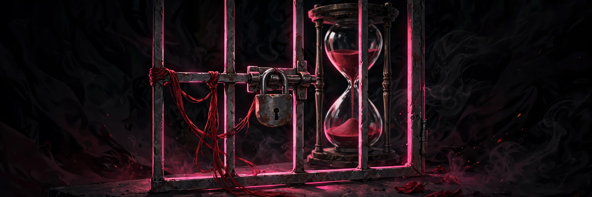

# Withheld

## 18+ — Adults Only

This game contains adult content. It is intended only for players 18 and older.

### Content notes

- Adult edging and denial, presented as a control-systems game about holding back.
- A fixed threshold: if the drive touches the wall, it is cut and latches off.
- A begging mechanic: a well-timed ask can improve the next term, never the current wall.
- A countdown term that records every trip and every term ridden.

All characters depicted are adults.

## An edging mini-game where you hold a rising drive just under a fixed wall without tripping it.

<a href="https://github.com/NTRanch/withheld">GitHub</a> · <a href="https://github.com/NTRanch/withheld/blob/main/LICENSE.md">License</a> · <a href="https://ntranch.itch.io">itch.io studio page</a>

## Built with

 

## What you do

Hold the canvas, or hold the space bar, to press her drive up the gauge. Release and it decays. The gold line on the gauge is the wall: touch it and the drive is cut, latched off, and the trip is written into the book.

You win by riding the rose band just under the wall for the number of seconds in your contract, before the term — shown as huge numerals counting down — runs out. Between attempts you can ask for more: an ask made while low, unlatched, and calm is filed, and the next term gets more time and a wider band. Asks made from the band or from the latch count as noise, and the wall never moves.

## Features

- Three levels with rising walls and longer rides: wall 78 and a 6.0-second ride in 90 seconds, wall 84 and 9.0 seconds with shifting gusts, and wall 90 and 12.0 seconds in 150 seconds.
- Settings for gust reduction and text size, reachable before any play.
- Banked petitions, settings, and the book — every trip, every latch second, every term ridden — persist in the browser.

## Media

- [Level 1 preview](../docs/previews/level-1-withheld.mp4)
- [Level 2 preview](../docs/previews/level-2-withheld.mp4)
- [Level 3 preview](../docs/previews/level-3-withheld.mp4)

## Controls

| Action | Keys |
| --- | --- |
| Press the drive up | Hold the canvas, or hold SPACE |
| Ask (file a petition) | B |

## Status

**v1.0.0** — complete. Built for the Torogao Jam Program (a 14-week, one-game-per-week programme) for the Gameotron jam on itch.io. This GitHub page is the game's home while itch project slots are unavailable.

To play, open `web/index.html` in a browser — one self-contained file that runs fully offline. Free to play.

## Credits

A Nice Thoughts Ranch game.

Made with Rust.
